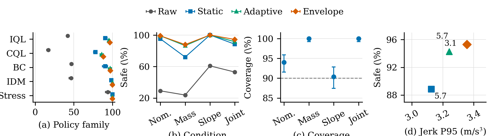
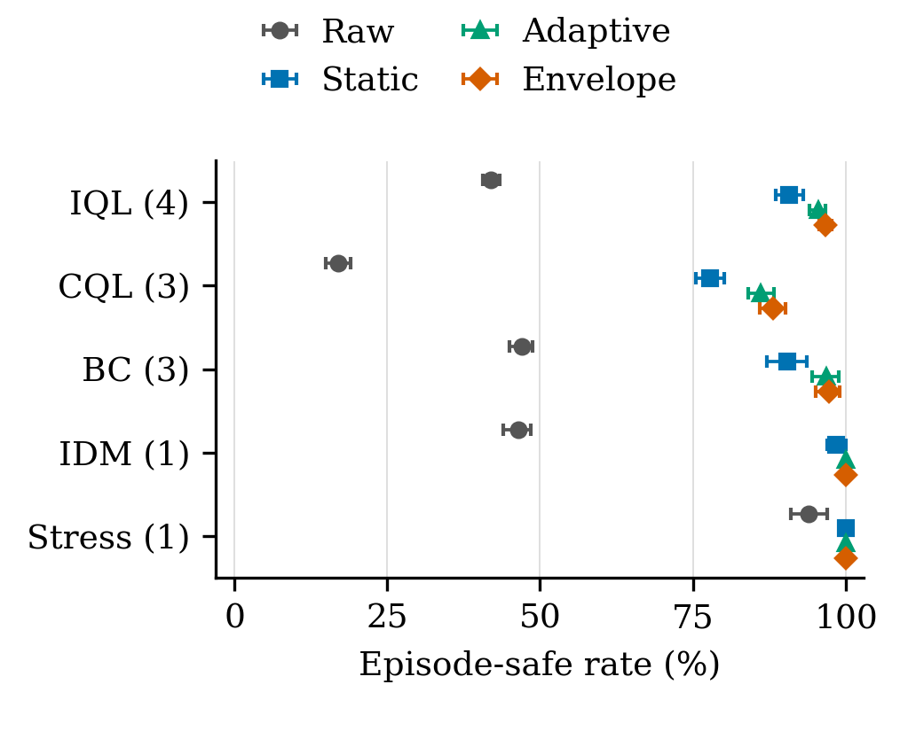
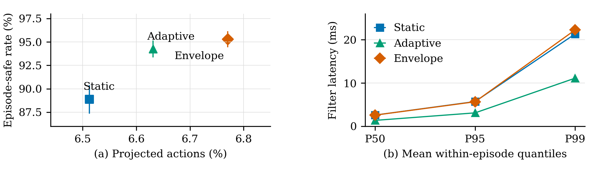

# RACF Vehicle Paper Repository

Private companion repository for the paper **Residual-Aware Conformal Action Filtering for Offline Reinforcement Learning in Adaptive Cruise Control** (RACF).

This repository is organized around the paper rather than the historical project workspace. It contains the paper-aligned implementation, experiment entry points, protocol snapshots, compact result summaries, figures, and the LaTeX source used to build the current manuscript. The repository is private while the manuscript is under review.

## Repository map

```text
src/racf/       Paper-aligned RACF, conformal, temporal, and utility modules
experiments/    Reproducible analysis/plotting entry points and frozen protocol
results/        Compact summaries used by the manuscript and generated tables
paper/          LaTeX source, figures, bibliography, and current preprint PDF
tests/          Unit and contract tests for the paper implementation
data/           Data manifest and instructions; raw/private arrays are excluded
models/         Model manifest and instructions; private checkpoints are excluded
```

## What the paper studies

RACF combines calibrated prediction residuals, a finite dynamics ensemble, and constrained action correction for deploying frozen offline-RL policies under dynamics variation. The paper evaluates static, adaptive, and fixed-envelope filters on paired adaptive-cruise-control trials and reports the safety/utility trade-off.

The repository preserves the paper's claim boundaries. Existing summaries are evidence snapshots, and a successful smoke test is not a full benchmark. Re-running a result requires the matching protocol, data, policy assets, seed, and environment manifest.

## Quick start

The supported environment is Python 3.10--3.12.

```bash
python -m venv .venv
# Linux/macOS: source .venv/bin/activate
# Windows PowerShell: .venv\\Scripts\\Activate.ps1
python -m pip install -r requirements-dev.txt
python -m pytest -q
```

The unit tests exercise the paper implementation without downloading data or models. The experiment scripts consume local assets described in `data/README.md` and `models/README.md`.

## Build the manuscript

From `paper/`, use an installed LaTeX environment with the bundled `spconf.sty` and `IEEEbib.bst`:

```bash
cd paper
pdflatex -interaction=nonstopmode main.tex
bibtex main
pdflatex -interaction=nonstopmode main.tex
pdflatex -interaction=nonstopmode main.tex
```

The checked-in `paper/RACF_ICASSP2027_preprint.pdf` is the current private reference build. Update it only after the source and figure audit passes.

## Reproducibility and privacy

No credentials, private HPC paths, scheduler logs, raw worker databases, or internal project journals belong in this repository. Large policy/data assets are referenced by manifest and remain outside Git until a release decision is made. Before making the repository public, audit every result, path, author field, and data/model license.


## Reproduce before reading the full evidence package

The public entry point is [`REPRODUCE.md`](REPRODUCE.md). Run:

```bash
python scripts/reproduce.py
```

This creates a deterministic synthetic smoke result and records the environment. It is deliberately labelled `mock test`; it validates the code path without exposing private raw data or claiming a full benchmark.

## Key paper figures







The figure/table crosswalk and paper-result boundary are documented in [`REPRODUCE.md`](REPRODUCE.md).

## Packaging reference

The organization follows the public replication-package pattern described in [`yhoriuchi/replication-package-guide`](https://github.com/yhoriuchi/replication-package-guide): one public run entry point, explicit data restrictions, a paper figure/table crosswalk, and a recorded environment. The implementation here is adapted to Python, LaTeX, and the RACF experiment protocol.

## Citation

If you use this code, cite the accompanying paper using the metadata in [`CITATION.cff`](CITATION.cff). The title, method name, and reported numbers should remain synchronized with `paper/main.tex`.

## Status

- Visibility: private GitHub repository
- Paper: ICASSP 2027 submission/preprint work in progress
- Scope: paper-aligned RACF implementation and evidence package
- Full benchmark status: not claimed by this repository


